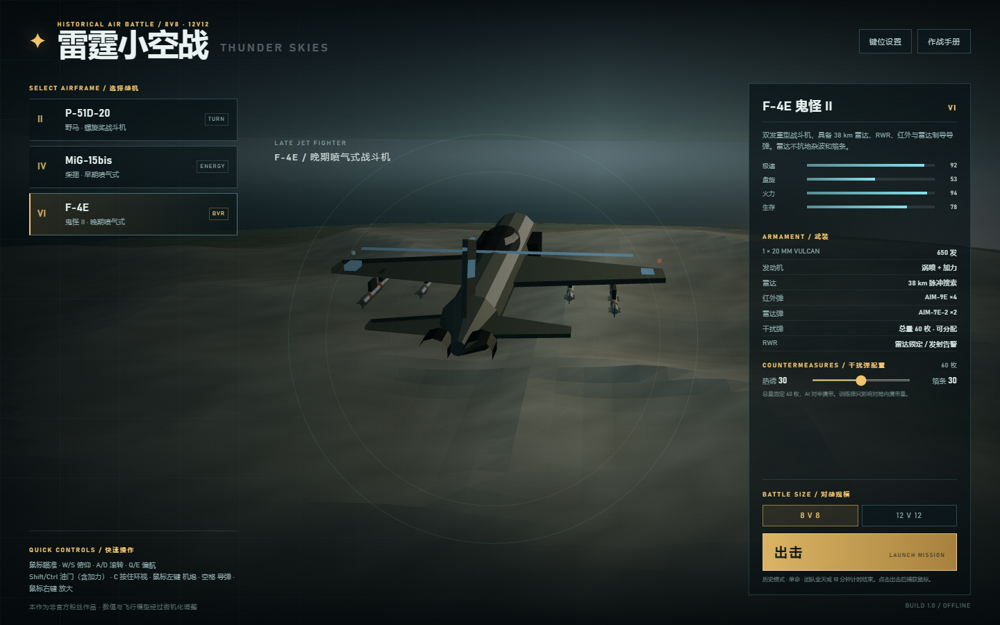
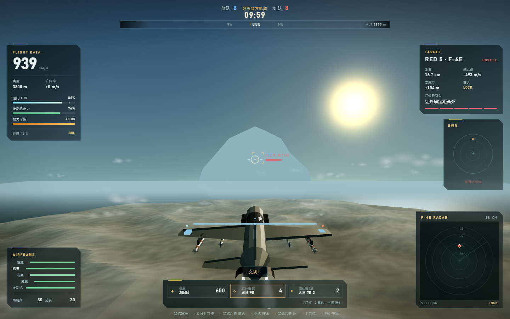

# 雷霆小空战 · THUNDER SKIES

一个可离线运行、超简易但系统较完整的 3D 类战雷空战小游戏。内置 AI 队伍、有限模块化损伤、随高度变化的发动机、F-4E 雷达 / RWR / 两种制导方式导弹 / 干扰弹，以及 8v8、12v12 历史模式空战。




## 启动

- 直接双击 `index.html`，或双击 `play.cmd`。
- 推荐当前版本的 **Chrome 或 Edge**，需要 WebGL。
- 无需安装、无需本地服务器、无运行期网络请求；Three.js 已放在 `vendor/three.min.js`。

## 默认操作

| 功能 | 默认键 |
|---|---|
| 鼠标瞄准 | 移动鼠标 |
| 抬头 / 低头 | W / S |
| 左滚 / 右滚 | A / D |
| 左偏航 / 右偏航 | Q / E |
| 增加 / 减少油门（100% 以上进入加力） | Shift / Ctrl |
| 自由观察（按住，绕飞机旋转） | C |
| 机炮 | 鼠标左键 |
| 发射所选导弹 | 空格 |
| 视野放大（点击切换，约 5 倍） | 鼠标右键 |
| 选择红外弹 / 雷达弹 | 1 / 2 |
| 切换 / 雷达锁定目标 | T |
| 热诱弹 / 箔条 | F / G |
| 战况板 | Tab |
| 暂停 / 菜单 | Esc（固定界面保险键） |
| 静音 | M |
| 观战切换 / 观战加速 | V / X |

- 所有战斗键位都可以在机库右上角「键位设置」或暂停菜单中重新绑定，支持键盘和鼠标按钮。
- `Esc` 始终作为界面保险键保留，不能绑定到战斗动作。
- 浏览器可能保留 `Ctrl+W` 等快捷键。游戏会在战斗时拦截已绑定按键的默认行为；若仍有冲突，请在设置中改键。
- 键位、干扰弹分配和静音设置保存在浏览器 `localStorage`。

## 玩法

- 机库中选择 P-51D-20、MiG-15bis 或 F-4E，并选择 8v8 或 12v12。玩家与 AI 队友对抗同规模 AI 敌机。
- 单命历史模式，无重生、无空中维修。10 分钟内全灭对方，或计时结束时存活人数更多的一方获胜。
- 玩家被击落后可继续观战；团队胜负照常结算。
- 同局双方使用同级别同型飞机，以蓝/红涂装区分。

### 发动机与飞行

- 油门 0–110%；100% 为军用全油门，继续推到 110% 进入加力/WEP。油门轴为线性：轻点 Shift/Ctrl 改变 4%，按住以恒定 32%/秒变化。
- 每型飞机有连续加力时限：P-51D 30 秒、MiG-15bis 20 秒、F-4E 40 秒。超时后发动机升温并开始损坏；收油门可冷却，但发动机损伤无法在本局恢复。
- 发动机出力随高度变化，速度由推力、空气密度、阻力和姿态共同决定，不是固定极速。性能参数已下调到更接近实际档位：极速、加速度和爬升能力均明显降低；陡爬升还受到该机型合理爬升率上限约束，避免出现不切实际的垂直爬升速度。
- 鼠标定义的是**世界空间中的瞄准方向**，不是持续偏移的操纵杆：飞机会自动协调滚转并转弯，直到机头指向该方向；屏幕上的琥珀色瞄准环会随相机转动自动回到中央，鼠标停住后飞机不会继续绕圈。垂直瞄准不会引起滚转；A/D 仍可手动压坡度。
- 追尾相机保持水平稳定，不跟随飞机滚转。
- 按住 C 时摄像机以飞机为中心环绕，不再只是原地转动视角；松开 C 平滑回到追尾视角。
- 点击鼠标右键切换约 5 倍放大，再次点击恢复。放大时鼠标操纵灵敏度会自动降低。

### 有限模块化损伤

机身、左翼、右翼、尾翼分别有独立耐久和命中盒。断翼或断尾会失控坠毁；机身毁坏立即被击落。发动机是机身内部子系统，可能被机身中弹或过热损坏，出力下降，严重时停车。

### F-4E 系统

- 38 km 前向雷达；按 T 切换接触并锁定。雷达可远距发现目标，但导弹仍有自己的发射包线。
- 雷达不抗干扰：地杂波、地形遮挡和箔条都会影响探测/锁定；低空目标可能被杂波吞没。雷达屏会显示杂波与假回波。
- AIM-9E 红外弹 ×4：发射后不管，受目标姿态、热信号和热诱弹影响，具有助推段和滑翔段。
- AIM-7E-2 雷达弹 ×2：需要持续雷达锁定；脱锁、箔条和地形遮蔽会让导弹失去制导。
- 导弹动力段和滑翔段有明显区别：动力段加速并喷烟，滑翔段无推力、持续减速。
- RWR 对雷达锁定和雷达弹发射告警，不对红外弹告警；红外弹没有接近提示。
- 热诱弹与箔条共用 60 枚总配额，可在机库自由分配。AI 固定 30/30。
- HUD 不提供机炮提前量指示。

### AI

AI 会追踪/雷达发现目标，进行 B&Z（爬升、俯冲、脱离）、面对雷达弹时执行简化的 39/横侧向机动并释放箔条、面对红外弹时释放热诱弹，并会在有效包线内发射 AIM-9E 和 AIM-7E-2。AI 同样受发动机、雷达、杂波、箔条和导弹能量模型约束。

## 文件结构

```
index.html              页面与 UI
styles.css              HUD、机库、设置界面样式
play.cmd                打开游戏的 Windows 快捷启动器
js/                     游戏逻辑
vendor/three.min.js     Three.js r158（MIT）
tests/smoke_test.py     Playwright 冒烟测试
```

## 开发与测试

运行冒烟测试需要 Python 3 和 Playwright：

```powershell
python tests/smoke_test.py
```

游戏在 `?test=1` 下会导出 `window.__thunder` 调试接口，用于自动化测试；正常游玩无需该参数。

## 说明

- 本作是非官方粉丝作品，与 Gaijin / War Thunder 无关；不使用其商标、模型或音频素材。
- 飞行模型、雷达、导弹与损伤均为简化游戏模拟；真实历史性能不是目标。
- Three.js r158 采用 MIT License，许可文件见 `vendor/THREE-LICENSE.txt`。
